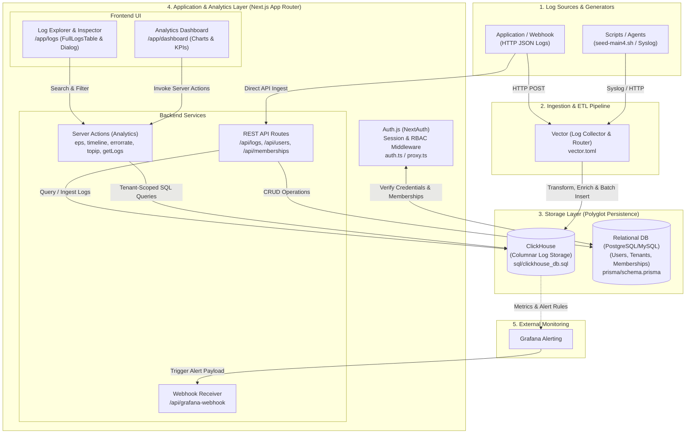
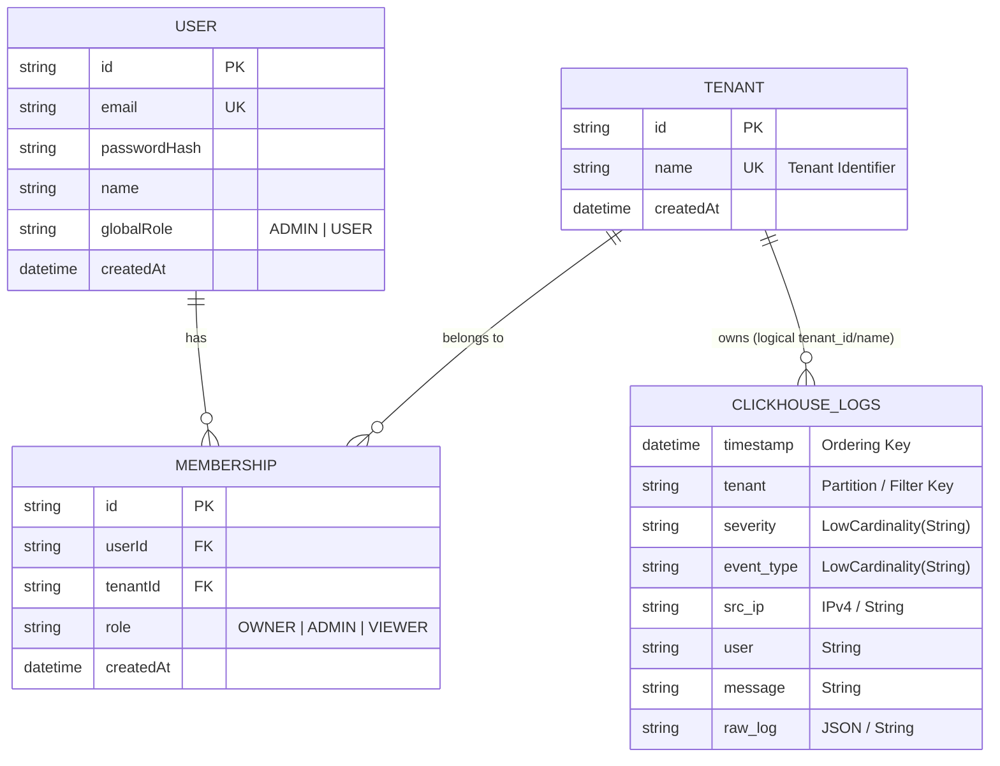

# System Architecture & Data Flow

เอกสารนี้อธิบายสถาปัตยกรรมของระบบ **Log Management & SIEM Analytics Platform** ซึ่งออกแบบมาเพื่อรองรับการรวบรวม แปลง จัดเก็บ และวิเคราะห์ข้อมูล Log ปริมาณมากในรูปแบบ Multi-Tenant พร้อมระบบแจ้งเตือนและการแสดงผลแบบ Real-time

## 1. ภาพรวมสถาปัตยกรรมระบบ (System Architecture Diagram)

แผนภาพด้านล่างแสดงองค์ประกอบหลักของระบบ ตั้งแต่แหล่งกำเนิดข้อมูล (Log Sources) ไปจนถึงส่วนการแสดงผลและแจ้งเตือน:

## 2. การไหลของข้อมูล (Data Flow)

การทำงานของข้อมูลในระบบแบ่งออกเป็น 3 เส้นทางหลัก (Pipelines) ดังนี้:

### 2.1 Log Ingestion Pipeline (การนำเข้าและแปลงข้อมูล Log)
1. **Log Generation**: ข้อมูล Log ถูกส่งเข้ามาจากระบบภายนอก หรือสคริปต์จำลองข้อมูล (เช่น `sendlog/seed-main4.sh` และ `sendlog/seed-revers-date.sh`)[cite: 1] ในรูปแบบ JSON หรือ Syslog ระบุข้อมูลสำคัญอย่าง `tenant`, `timestamp`, `event_type`, `severity`, `src_ip`, `user` และ `message`
2. **Collection & Normalization (Vector)**: **Vector** (`vector.toml`)[cite: 1] ทำหน้าที่เป็นตัวรับข้อมูลด่านหน้า (Ingestion Pipeline) โดยทำการ:
   * รับข้อมูลจาก Sources ต่างๆ
   * แปลงโครงสร้างข้อมูล (Parsing & Remapping) ด้วย VRL (Vector Remap Language) ให้ตรงกับ Schema มาตรฐานของฐานข้อมูล
   * จัดกลุ่มข้อมูล (Batching) เพื่อลดภาระการเขียนลงฐานข้อมูล
3. **High-Performance Storage (ClickHouse)**: ข้อมูลที่ผ่านการแปลงแล้วจะถูกเขียนลงในฐานข้อมูล **ClickHouse** (`sql/clickhouse_db.sql`)[cite: 1] ซึ่งเป็นฐานข้อมูลแบบ Columnar ที่ออกแบบมาเพื่อการทำ Analytics โดยเฉพาะ รองรับการบีบอัดข้อมูลอัตราสูงและการ Query ข้อมูลระดับล้านแถวในเสี้ยววินาที (นอกจากนี้ยังรองรับการยิงผ่าน API `/api/logs` และ `/api/logs/[tenant]` โดยตรง)[cite: 1]

### 2.2 Query & Analytics Pipeline (การดึงข้อมูลและประมวลผลหน้า Dashboard)
1. **User Request & Session Check**: เมื่อผู้ใช้งานเปิดหน้า `/dashboard` หรือ `/logs`[cite: 1] ระบบจะตรวจสอบสิทธิ์ผ่าน `auth.ts` และ `proxy.ts`[cite: 1] เพื่อดึงข้อมูลผู้ใช้และสิทธิ์การเข้าถึง Tenant ปัจจุบัน
2. **Server Actions Execution**: หน้าเว็บเรียกใช้งาน Next.js Server Actions ในโฟลเดอร์ `app/actions/`[cite: 1] แบบขนาน (Parallel Fetching) เพื่อคำนวณค่าสถิติจาก ClickHouse (`lib/clickhouse.ts`)[cite: 1] ได้แก่:
   * `eps.ts`: คำนวณอัตรา Events Per Second (EPS)[cite: 1]
   * `tiimeline.ts`: ดึงกราฟแนวโน้มปริมาณ Log ตามช่วงเวลา (`eventTimeLine.tsx`)[cite: 1]
   * `errorrate.ts`, `criticalalerts.ts`, `blockedrequests.ts`: คำนวณ KPI ด้านความปลอดภัยและข้อผิดพลาด[cite: 1]
   * `topip.ts`, `topuser.ts`, `eventtype.ts`: จัดอันดับ IP ต้นทาง, ผู้ใช้งาน และประเภทเหตุการณ์ที่พบบ่อย (`TopIPCharts.tsx`, `TopUser.tsx`, `TopEventType.tsx`)[cite: 1]
   * `getLogs.ts`: ดึงรายการ Log แบบแบ่งหน้า (Pagination) พร้อมตัวกรอง (Search, Severity, Tenant, Time Range) เพื่อแสดงใน `FullLogsTable.tsx` และดูรายละเอียดเชิงลึกผ่าน `LogInspectDialog.tsx`[cite: 1]

### 2.3 Alerting & Webhook Pipeline (การแจ้งเตือนเหตุผิดปกติ)
1. ระบบ 모니터링 (เช่น Grafana) ทำการตรวจสอบเงื่อนไขความผิดปกติจากฐานข้อมูล ClickHouse
2. เมื่อพบเหตุการณ์ที่เข้าเงื่อนไข (เช่น Critical Alert พุ่งสูงผิดปกติ หรือพบการโจมตีซ้ำๆ) จะส่ง HTTP POST มายัง Endpoint `/api/grafana-webhook/route.ts`[cite: 1] เพื่อบันทึกหรือกระจายการแจ้งเตือนต่อไป

## 3. โมเดลการจัดการหลายองค์กร (Multi-Tenant & RBAC Model)

ระบบออกแบบโดยใช้สถาปัตยกรรม **Shared Database, Shared Schema (Logical Isolation)** ร่วมกับการแยกบทบาทฐานข้อมูลออกเป็น 2 ส่วน (Polyglot Persistence):

### 3.1 การจัดการตัวตนและสิทธิ์การเข้าถึง (Control Plane — Prisma ORM)
ข้อมูลผู้ใช้งาน องค์กร (Tenant) และการผูกสิทธิ์ จะถูกจัดเก็บในฐานข้อมูลเชิงสัมพันธ์ผ่าน **Prisma** (`prisma/schema.prisma` และ `lib/prisma.ts`)[cite: 1] โดยมีโครงสร้างหลักดังนี้:
* **Users (`/api/users`)**: เก็บข้อมูลบัญชีผู้ใช้และรหัสผ่านที่เข้ารหัสผ่าน `utils/password.ts`[cite: 1]
* **Tenants (`/api/teants` & `getTenants.ts`)**: เก็บรายชื่อหน่วยงานหรือลูกค้าแต่ละรายที่ใช้งานระบบ[cite: 1]
* **Memberships (`/api/memberships` & `/api/createMembership`)**: ตารางเชื่อมโยงแบบ Many-to-Many ระหว่าง `User` และ `Tenant`[cite: 1] ทำให้ผู้ใช้ 1 คนสามารถสังกัดได้หลายองค์กร และกำหนดสิทธิ์แยกตามองค์กรได้

### 3.2 การคัดกรองและแยกข้อมูล Log (Data Plane Isolation — ClickHouse)
ข้อมูล Log ของทุก Tenant จะถูกจัดเก็บไว้ในตารางเดียวกันบน ClickHouse เพื่อประสิทธิภาพในการบริหารจัดการทรัพยากร แต่มีการบังคับใช้ **Logical Data Isolation** อย่างเคร่งครัดในระดับ Application Layer:
* **Tenant Tagging**: ทุกๆ Log Event ที่ไหลเข้าสู่ระบบ (ทั้งผ่าน Vector และ API `/api/logs/[tenant]`)[cite: 1] จะต้องมีฟิลด์ระบุชื่อหรือรหัส `tenant` กำกับเสมอ
* **Query-Level Filtering**: ทุกครั้งที่มีการเรียกใช้ Server Actions (`app/actions/*.ts`) หรือ API (`/api/logs/[tenant]`)[cite: 1] ระบบจะตรวจสอบสิทธิ์ของผู้ใช้จาก Session (`auth.ts`)[cite: 1] ว่ามี Membership อยู่ใน Tenant ที่ร้องขอหรือไม่ จากนั้นจะบังคับแนบเงื่อนไข `WHERE tenant = {selected_tenant}` (หรือ `WHERE tenant IN (allowed_tenants)`) ลงในคำสั่ง SQL ของ ClickHouse เสมอ
* **Admin View (All Tenants)**: สำหรับผู้ดูแลระบบที่มีสิทธิ์เข้าถึงหลาย Tenant สามารถสลับดูข้อมูลราย Tenant หรือดูภาพรวมผ่านตัวเลือกบน Navigation Bar (`DashNav.tsx`)[cite: 1] โดยระบบจะจำกัดขอบเขตข้อมูลเฉพาะ Tenant ที่ผู้ใช้นั้นมีสิทธิ์เข้าถึงเท่านั้น

## 4. โครงสร้างไดเรกทอรีที่สำคัญ (Key Directory Mapping)

* **`/app/actions/`**: Server Actions สำหรับ Query ข้อมูลสถิติและ Log จาก ClickHouse ส่งตรงไปยัง UI Components[cite: 1]
* **`/app/api/`**: RESTful API สำหรับจัดการ Authentication (`[...nextauth]`), ผู้ใช้งาน (`users`), องค์กร (`teants`), สิทธิ์การเข้าถึง (`memberships`, `createMembership`), การรับส่ง Log (`logs/[tenant]`) และ Webhook (`grafana-webhook`)[cite: 1]
* **`/components/charts/`**: คอมโพเนนต์แสดงผลกราฟสถิติต่างๆ บนหน้า Dashboard[cite: 1]
* **`/components/tables/` & `/components/dialog/`**: ตารางแสดงผลรายการ Log (`FullLogsTable.tsx`, `RecentLogsTable.tsx`) และหน้าต่างตรวจสอบรายละเอียด Log เชิงลึก (`LogInspectDialog.tsx`)[cite: 1]
* **`/lib/`**: ตัวจัดการการเชื่อมต่อฐานข้อมูล `clickhouse.ts` และ `prisma.ts`[cite: 1]
* **`/prisma/` & `/sql/`**: ไฟล์กำหนด Schema และ Migration ของฐานข้อมูลหลักและ ClickHouse[cite: 1]
* **`/sendlog/` & `vector.toml`**: สคริปต์จำลองการยิงข้อมูล Log และการตั้งค่า Pipeline ของ Vector[cite: 1]